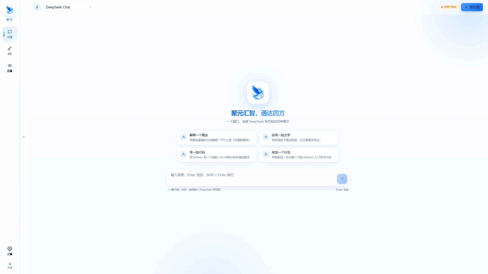

<div align="center">


# 聚元 · AI 模型聚合网关

**把网页版 DeepSeek，变成你自己的 OpenAI 兼容 API。**

本地运行 · 一键启动 · 统一对话 · 浅色控制台

<br />


</div>



> **安全定位**：本项目默认只监听 `127.0.0.1`，面向**本机个人使用**。请勿直接暴露到公网，也不要提交自己的账号 Cookie、API Key 或数据库文件。

---

## 一、这是什么？

聚元是一个跑在你电脑上的 **AI 聚合网关**。

它通过受控浏览器登录 DeepSeek 网页版，把网页对话能力转换成标准的 **OpenAI / Anthropic 兼容接口**，同时提供一个浅色系的 Web 控制台。

你可以用它来：

- 在聚元控制台里直接和 DeepSeek 对话；
- 给 Trae、Cursor、Claude Code、各类 SDK 签发 API Key；
- 用标准的 `/v1/chat/completions` 调用网页版 DeepSeek；
- 管理 DeepSeek 账号登录态、模型与会话历史。

> 当前版本**只正式支持 DeepSeek**，共 4 个模型；AUTO 智能路由与多平台模型清单已下线。

---

## 二、当前支持的模型

| 模型名 | 对应模式 | 说明 |
| --- | --- | --- |
| `deepseek-chat` | Chat | 标准对话 |
| `deepseek-reasoner` | Reasoner | 深度思考 |
| `deepseek-chat-online` | Chat · 联网 | 标准对话 + 联网搜索 |
| `deepseek-reasoner-online` | Reasoner · 联网 | 深度思考 + 联网搜索 |

---

## 三、核心能力

| 能力 | 说明 |
| --- | --- |
| **一键启动** | 双击 `JuyuanLauncher.exe`，自动拉起受控浏览器、底座服务与聚合网关 |
| **OpenAI 兼容** | 对外提供 `/v1/chat/completions`、`/v1/models`，兼容常见 SDK 与桌面工具 |
| **Anthropic 兼容** | 同时提供 `/v1/messages` 接口 |
| **账号池** | 导入 DeepSeek 登录态，支持应用登录态、连通性体检与状态管理 |
| **对话连续性** | 同一聚元会话复用同一个网页对话；只有点「新对话」时才在网页端新建 |
| **API Key 管理** | 在控制台签发、禁用、删除密钥，并按模型授权 |
| **浅色控制台** | 对话、API、账号、模型配置统一管理，带流式输出与交互动效 |
| **本地优先** | 所有请求由本机后端转发，账号凭据加密存储在本地 |

---

## 四、项目结构

```text
juyuan_code/
├── backend/                        # FastAPI 聚合网关
│   ├── app/
│   │   ├── api/                    # OpenAI / Anthropic / 管理接口
│   │   ├── browser/                # 受控浏览器 CDP 登录态注入
│   │   ├── gateway/                # 请求编排与账号调度
│   │   ├── platforms/              # DeepSeek 网页适配器
│   │   ├── storage/                # SQLite 会话 / 密钥 / 日志
│   │   └── resources/              # platforms.json（模型与别名）
│   ├── requirements.txt
│   ├── requirements-web.txt        # 真实浏览器依赖
│   └── .env.example
│
├── frontend/                       # Vite + React 19 + Tailwind CSS 4
│   ├── src/
│   ├── public/juyuan-logo.png
│   └── dist/                       # 构建后由后端托管（不提交）
│
├── vendor/universal-web-api/       # 底座：网页自动化 + 受控浏览器（需自行 clone）
├── patches/
│   └── universal-web-api-juyuan.patch   # 聚元对底座的本地补丁
│
├── docs/images/                    # README 截图与 Logo
├── juyuan_launcher.py              # 一键启动器源码
├── JuyuanLauncher.exe              # 本地构建产物（不提交，需自行生成）
├── start.cmd / start.sh            # 仅启动网关（开发调试用）
├── docker-compose.yml
└── LICENSE
```

---

## 五、部署前准备

| 依赖 | 要求 | 用途 |
| --- | --- | --- |
| **系统** | Windows 10 / 11（推荐） | 一键启动器与受控浏览器主要在 Windows 验证 |
| **Python** | 3.10+（推荐 3.11 / 3.12） | 后端与底座 |
| **Node.js** | 18+，自带 npm | 构建前端 |
| **Git** | 任意较新版本 | 克隆仓库与底座、应用补丁 |
| **浏览器** | Microsoft Edge 或 Google Chrome | 受控浏览器 |
| **网络** | 可访问 GitHub / PyPI / npm | 首次安装依赖 |

> **路径建议**：把项目放在**不含中文、不含空格**的目录，例如 `D:\juyuan`。  
> 后续所有命令默认在项目根目录执行。

---

## 六、从零部署（按顺序执行）

### 第 1 步：克隆聚元仓库

```powershell
git clone https://github.com/jiaweisi666/juyuan.git
cd juyuan
```

---

### 第 2 步：克隆底座 `universal-web-api`

聚元复用 [`lumingya/universal-web-api`](https://github.com/lumingya/universal-web-api) 作为网页自动化底座，需要把它放到 `vendor/universal-web-api`：

```powershell
git clone https://github.com/lumingya/universal-web-api.git vendor/universal-web-api
```

> 本项目的补丁基于底座 **v3.0.0（commit `29d9685`）** 验证。若上游已更新且补丁无法应用，可先切到该版本：
>
> ```powershell
> git -C vendor/universal-web-api checkout 29d9685
> ```

---

### 第 3 步：应用聚元底座补丁（重要）

底座需要两个本地补丁：

1. 阈值为 0 时复用当前网页对话，而不是每轮新建；
2. 支持聚元首轮会话的「新建对话」标记。

在**项目根目录**执行：

```powershell
git -C vendor/universal-web-api apply ../../patches/universal-web-api-juyuan.patch
```

检查是否生效：

```powershell
git -C vendor/universal-web-api status --short
```

应看到以下 4 个文件被修改：

```text
 M app/api/chat.py
 M app/api/tab_routes.py
 M app/core/browser/workflow.py
 M app/core/tab_pool_parts/session.py
```

> 如果补丁因为上游代码变化而无法应用，可以打开 `patches/universal-web-api-juyuan.patch` 手动对照修改，或提交 Issue。

---

### 第 4 步：安装后端依赖

```powershell
cd backend
python -m venv .venv
.\.venv\Scripts\python.exe -m pip install -U pip
.\.venv\Scripts\python.exe -m pip install -r requirements.txt
.\.venv\Scripts\python.exe -m pip install -r requirements-web.txt
cd ..
```

> `requirements-web.txt` 包含 DrissionPage、websocket-client 等真实浏览器依赖，使用真实 DeepSeek 网页版时**必须安装**。

---

### 第 5 步：安装底座依赖

```powershell
cd vendor\universal-web-api
python -m venv venv
.\venv\Scripts\python.exe -m pip install -U pip
.\venv\Scripts\python.exe -m pip install -r requirements.txt
cd ..\..
```

> 也可以直接运行一次 `vendor\universal-web-api\start.py`，它会自动创建虚拟环境并安装依赖；但那会同时启动服务，完成后记得停止。  
> 注意：运行前建议设置环境变量 `AUTO_UPDATE_ENABLED=false`，避免底座自动更新覆盖第 3 步的补丁。

---

### 第 6 步：创建后端环境变量

```powershell
copy backend\.env.example backend\.env
notepad backend\.env
```

建议首次部署至少确认以下配置：

```ini
GATEWAY_HOST=127.0.0.1
GATEWAY_PORT=8300
GATEWAY_DEBUG=false

# 本机使用建议留空：打开面板不需要额外令牌
GATEWAY_API_KEY=
GATEWAY_ADMIN_TOKEN=

# 开启真实 DeepSeek 网页适配
GATEWAY_REAL_BROWSER_ENABLED=true
GATEWAY_MOCK_FALLBACK=true
GATEWAY_BASE_WEB_API_URL=http://127.0.0.1:8199
```

> 第三方应用调用时，建议在控制台的「API」页面新建 API Key，而不是把 `GATEWAY_API_KEY` 写死。  
> `.env` 与 `backend/data/` 都不会提交到 Git。

---

### 第 7 步：构建前端

```powershell
cd frontend
npm ci
npm run build
cd ..
```

构建完成后，`frontend/dist/` 会由后端自动托管。

---

### 第 8 步：先启动一次，确认环境正常

```powershell
python juyuan_launcher.py
```

启动器会按顺序完成：

1. 启动受控浏览器（CDP `9222`）；
2. 启动底座服务（`8199`）；
3. 启动聚合网关（`8300`）；
4. 自动打开浏览器访问 `http://127.0.0.1:8300`。

看到控制台页面后，按 `Ctrl + C` 退出即可。  
确认没问题后，再进行下一步生成 exe。

---

### 第 9 步：打包 `JuyuanLauncher.exe`（双击启动）

```powershell
.\backend\.venv\Scripts\python.exe -m pip install pyinstaller
.\backend\.venv\Scripts\pyinstaller.exe --onefile --name JuyuanLauncher --distpath . --workpath build --specpath build --noconfirm juyuan_launcher.py
```

执行完成后，项目根目录会出现：

<div align="center">
  
  <br />
  <b>JuyuanLauncher.exe</b>
</div>

**以后直接双击 `JuyuanLauncher.exe` 即可启动整套服务。**

> 注意：exe 必须与 `backend/`、`frontend/`、`vendor/` 放在同一级目录，**不要单独移动 exe**。  
> 不想打包也可以每次都运行 `python juyuan_launcher.py`，效果相同。

---

### 第 10 步：导入 DeepSeek 登录态

首次使用必须让聚元拿到你的 DeepSeek 网页登录态：

1. 打开 `http://127.0.0.1:8300`；
2. 左侧进入 **配置 → 账号管理**；
3. 点击 **登录导入**，选择 **DeepSeek**；
4. 受控浏览器会打开 `https://chat.deepseek.com`，**请手动完成登录**；
5. 登录完成后回到控制台，聚元会自动轮询并写入账号；
6. 如果账号已存在但状态异常，点击 **应用登录态** 重新注入即可。

账号状态显示 **正常**、平台显示 **就绪** 后，就可以去「对话」页面使用了。

> 当前版本「应用登录态」只会复用已有标签页，或最多新开 1 个标签页，不会一次弹出 3 个。

---

## 七、日常使用

### 启动

双击 `JuyuanLauncher.exe`，等待黑色窗口出现并自动打开浏览器。

三个本地端口：

| 端口 | 服务 |
| --- | --- |
| `8300` | 聚元控制台 / 聚合网关 |
| `8199` | 底座 universal-web-api |
| `9222` | 受控浏览器 CDP |

### 停止

在启动器窗口按 `Ctrl + C`，或直接关闭窗口，启动器会清理所有子进程。

### 开发调试

只启动网关（不含底座/受控浏览器）：

```powershell
start.cmd
```

> `start.cmd` 只负责创建后端虚拟环境、安装依赖、构建前端并启动网关，**不等于完整一键启动**。

---

## 八、使用 API

### 1. 创建 API Key

1. 左侧进入 **API**；
2. 点击 **新建密钥**；
3. 选择要授权的模型，或留空表示授权全部 4 个模型；
4. 复制生成的 `sk-juyuan-...` 密钥。

### 2. OpenAI 兼容调用

```bash
curl http://127.0.0.1:8300/v1/chat/completions \
  -H "Authorization: Bearer <你的密钥>" \
  -H "Content-Type: application/json" \
  -d '{
    "model": "deepseek-chat",
    "messages": [
      { "role": "user", "content": "你好，介绍一下你自己" }
    ],
    "stream": true
  }'
```

Base URL：

```text
http://127.0.0.1:8300/v1
```

### 3. 在 Trae / Cursor 等工具中配置

- 提供方：**OpenAI 兼容**
- Base URL：`http://127.0.0.1:8300/v1`
- API Key：在聚元「API」页面生成的密钥
- 模型：`deepseek-chat`（或其它三个模型）

> 聚元与第三方应用需要运行在同一台电脑上，因为默认只监听 `127.0.0.1`。

---

## 九、常见问题

**Q：双击 `JuyuanLauncher.exe` 黑窗口一闪而过？**  
A：通常是虚拟环境或依赖没装好。请按「从零部署」重新确认：
- `backend/.venv` 是否存在；
- `vendor/universal-web-api/venv` 是否存在；
- 是否安装了 `backend/requirements-web.txt`；
- 项目路径是否包含中文或空格。

**Q：浏览器没有自动打开？**  
A：手动访问 `http://127.0.0.1:8300`。如果打不开，检查 `8300` / `8199` / `9222` 是否被占用。

**Q：页面显示「服务繁忙」或对话没有回复？**  
A：进入 **配置 → 账号管理**，确认账号状态为「正常」。如果异常，重新点击「应用登录态」；仍不行就重新「登录导入」。

**Q：对话会不会每轮都新开一个 DeepSeek 会话？**  
A：不会。当前版本同一聚元会话会复用同一个网页对话；只有点击「新对话」时才新建。

**Q：「同步底座模型」为什么只显示 4 个模型？**  
A：这是预期行为。底座返回的 `chat.deepseek.com`、`www.chat.deepseek.com` 等是站点标识，不是模型，聚元会自动忽略。

**Q：API Key 弹窗里为什么没有 AUTO 了？**  
A：AUTO 已下线。当前只支持四个 DeepSeek 模型。

**Q：如何更新前端？**  
A：

```powershell
cd frontend
npm ci
npm run build
cd ..
```

然后重启 `JuyuanLauncher.exe`。

**Q：更新了底座源码后补丁丢了怎么办？**  
A：重新执行：

```powershell
git -C vendor/universal-web-api apply ../../patches/universal-web-api-juyuan.patch
```

---

## 十、安全说明

- 默认只监听 `127.0.0.1`，不提供公网部署方案；
- DeepSeek Cookie / localStorage 使用 Fernet 加密存储在本地；
- `.env`、`backend/data/`、`frontend/dist/`、`vendor/` 均不会提交到仓库；
- 请勿把包含账号凭据的 `backend/data/` 目录发给他人；
- 如果要在局域网内使用，请自行评估风险并增加鉴权，不要直接暴露端口。

---

## 十一、技术栈

| 层 | 技术 |
| --- | --- |
| 后端 | Python · FastAPI · Uvicorn · Pydantic · SQLite · SSE |
| 前端 | Vite 6 · React 19 · Tailwind CSS 4 |
| 网页自动化 | [`lumingya/universal-web-api`](https://github.com/lumingya/universal-web-api) · DrissionPage · CDP |
| 打包 | PyInstaller（`JuyuanLauncher.exe`） |

---

## 十二、致谢与许可

- 网页自动化底座：[`lumingya/universal-web-api`](https://github.com/lumingya/universal-web-api)
- 本项目基于该底座二次开发，感谢上游作者的开源工作。
- 本项目使用 **AGPL-3.0** 许可证，详见 [`LICENSE`](LICENSE)。

<div align="center">

**聚元汇智，通达四方。**

如果这个项目对你有帮助，欢迎点一个 ⭐ Star。

</div>
